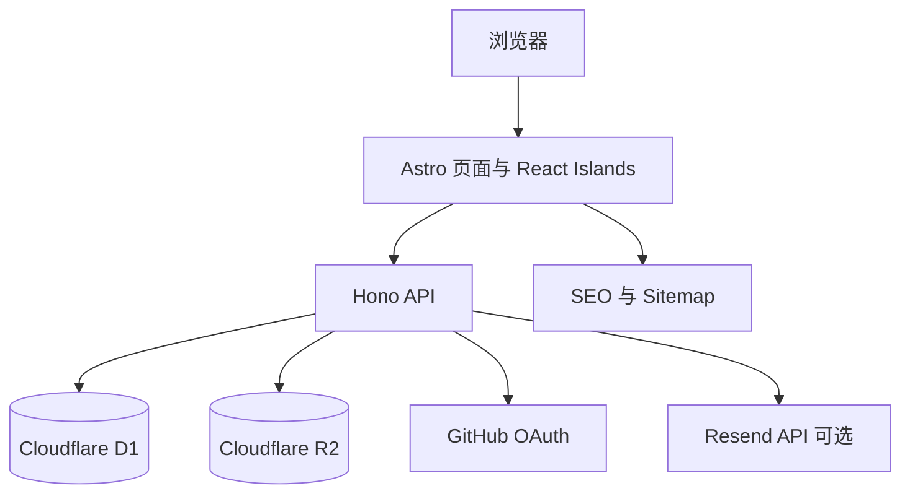
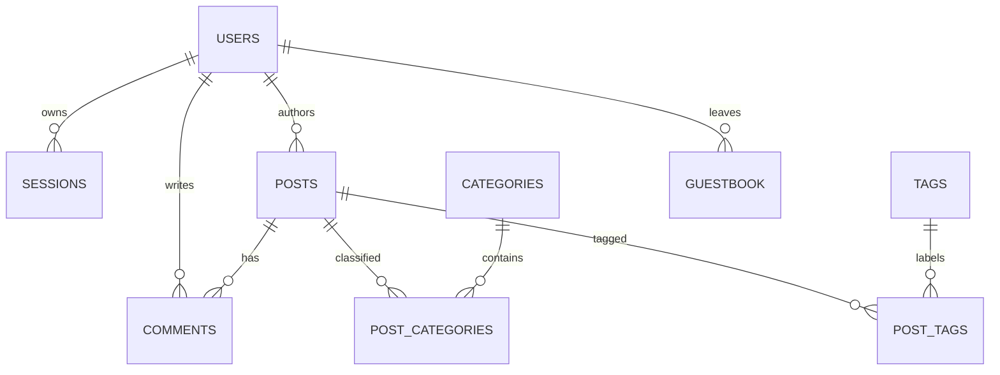
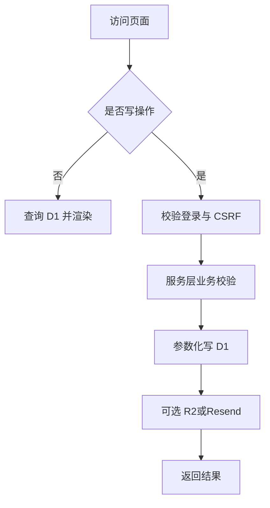

# 代码分析报告：个人博客网站

## 元数据
- 需求编号：PERSONAL-BLOG-001
- 扫描时间：2026-10-11
- 扫描范围：`C:\Users\wkl\Desktop\codex_work_space\personal-blog`
- 项目状态：Greenfield，原工作区无个人博客代码

## 1. 技术栈总览

| 类别 | 技术 | 版本策略 | 用途 |
|------|------|----------|------|
| 页面框架 | Astro | 当前稳定版 | 静态优先与 SSR 内容页 |
| 样式 | Tailwind CSS | v4 | 设计令牌、响应式与暗色模式 |
| 交互岛 | React | 当前稳定版 | 编辑器、评论、搜索、主题切换 |
| API | Hono | 当前稳定版 | `/api` 路由、中间件、D1/R2 访问 |
| 运行时 | Cloudflare Workers | Wrangler 本地模拟 | 边缘运行与部署 |
| 数据库 | Cloudflare D1 | SQLite | 用户、文章、互动、配置 |
| 对象存储 | Cloudflare R2 | 本地模拟 | 封面与附件 |
| 认证 | GitHub OAuth PKCE | 条件启用 | 生产免密登录 |
| 邮件 | Resend HTTP API | 条件启用 | 评论/留言通知 |
| 质量 | TypeScript + ESLint + Astro Check | 构建门禁 | 类型与编译验证 |

## 2. 项目架构

### 分层说明

| 层 | 目录 | 职责 | 禁止 |
|----|------|------|------|
| 页面层 | `src/pages` | 路由、SEO、初始数据装配 | 写业务 SQL |
| 组件层 | `src/components` | 展示与交互岛 | 直接访问 D1 |
| API 层 | `src/server/routes` | HTTP 校验、鉴权、响应 | 拼字符串 SQL |
| 服务层 | `src/server/services` | 业务规则、权限、聚合 | 返回 Response |
| 数据层 | `src/server/db` | 参数化查询、事务、映射 | 泄露到页面组件 |
| 类型层 | `src/types` | API 与领域类型 | 存放运行逻辑 |

## 3. 数据模型

| 业务域 | 表 | 说明 |
|--------|----|------|
| 身份 | `users`、`sessions`、`oauth_states` | OAuth、会话、CSRF |
| 内容 | `posts`、`categories`、`tags`、`post_categories`、`post_tags` | 文章与分类标签 |
| 互动 | `comments`、`guestbook` | 评论、回复、留言、审核 |
| 配置 | `site_settings` | 博主资料、公告、关于页、导航配置 |

核心设计约束：
- 主键使用 TEXT UUID，适配 D1 与 OAuth 用户标识。
- 所有业务表包含 `created_at`、`updated_at`、`created_by`、`updated_by`、`deleted_at`、`version`。
- 状态字段用受控文本枚举并在类型层约束，不使用裸数字魔法值。
- 列表查询按发布状态、时间、分类、标签建立复合索引；关联数据批量查询，禁止 N+1。

## 4. 业务域梳理

| 业务域 | 核心入口 | 核心能力 |
|--------|----------|----------|
| 内容浏览 | `src/pages/index.astro`、`src/pages/post` | 首页、列表、详情、归档、搜索 |
| 分类体系 | `src/pages/tags`、`src/pages/categories` | 标签云、分类树、筛选 |
| 用户认证 | `src/server/routes/auth.ts` | OAuth PKCE、开发登录、会话 |
| 互动 | `src/server/routes/comments.ts`、`guestbook.ts` | 发布、回复、审核、邮件通知 |
| 后台 | `src/pages/admin`、`src/server/routes/admin.ts` | 文章 CRUD、上传、审核、统计 |
| 个性化 | React Islands | 主题、繁简、全屏、打印、搜索 |

## 5. 外部依赖

| 类型 | 目标 | 用途 | 失败策略 |
|------|------|------|----------|
| OAuth | GitHub | 生产登录 | 本地开发登录降级；生产报错 |
| 邮件 | Resend | 通知 | 记录日志，不影响业务 |
| 存储 | R2 | 封面与附件 | 返回明确错误，不写半成品 |
| 数据库 | D1 | 全站数据 | 本地迁移；生产由用户审核执行 |
| 部署 | Cloudflare | Workers/D1/R2 | 本任务不执行云端发布 |

## 6. 风险点与建议

| 级别 | 问题 | 建议 |
|------|------|------|
| P0 | 动态文章与纯静态输出的天然冲突 | 采用静态优先 + 仅内容页边缘渲染，互动/搜索使用 Islands |
| P0 | 本地无 GitHub/Resend 密钥 | 提供开发登录与可选邮件降级，生产配置显式校验 |
| P0 | Worker 环境依赖兼容 | 构建阶段实际 bundle 验证，禁用 Node 专属库 |
| P1 | 文章增长后标签/分类 N+1 | 关联查询使用 `IN` 批量组装配 |
| P1 | 评论邮件拖慢请求 | `ctx.waitUntil` 异步发送，失败只记日志 |
| P1 | 繁简转换误伤代码/路径 | 仅转换标记区域，跳过 `code/pre/script/style/input` |
| P2 | 娱乐/工具箱需求内容不完整 | 保留结构化路由与占位内容，后续替换数据源 |

## 附录

### A. 配置文件索引
- `astro.config.mjs`
- `wrangler.jsonc`
- `package.json`
- `tsconfig.json`
- `migrations/*.sql`

### B. 关键路径索引
- `src/pages/api/[[...route]].ts`：Astro 到 Hono 的桥接
- `src/server/app.ts`：Hono 应用与中间件
- `src/server/db/*`：D1 查询层
- `src/server/services/*`：内容、认证、互动服务
- `src/components/*`：交互 Islands 与展示组件
