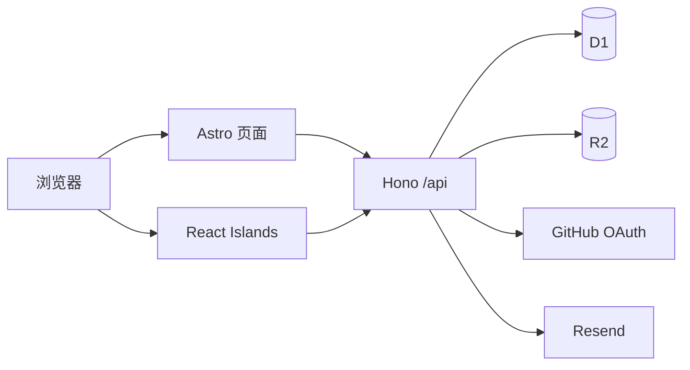
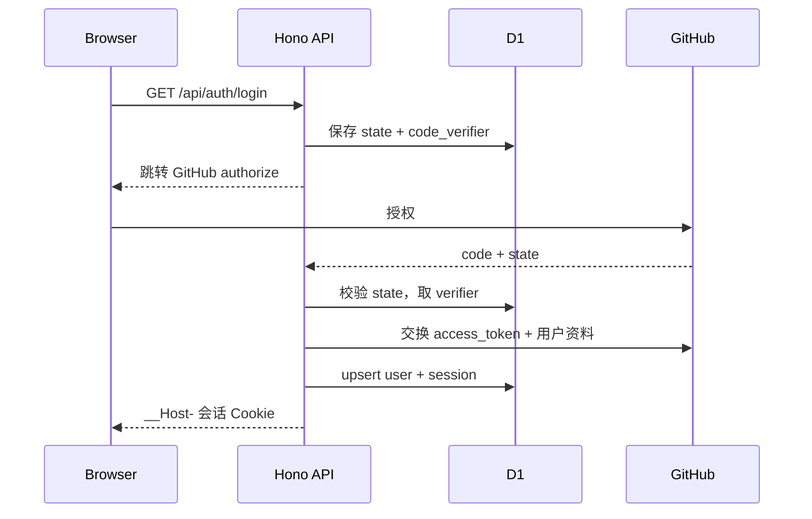

# 技术方案：个人博客网站

## 1. 修订记录

| 版本 | 日期 | 修订人 | 修订内容 |
|------|------|--------|----------|
| v1.0 | 2026-10-11 | 老王 | 初始方案 |
| v1.1 | 2026-10-11 | 老王 | 字体定稿 975 圆体；主题扩展为日间 3 套 + 夜间 3 套 |

## 2. 需求背景

### 2.1 现状
本地工作区没有个人博客代码，需求以 Word 文档给出；用户要求不推送、不找外部确认，直接完成本地开发与验证。

### 2.2 需求分析
建设一个可本地运行并具备生产部署路径的个人博客：内容浏览、文章管理、OAuth、评论/留言、R2 上传、主题/繁简/阅读增强、SEO 与安全防护。

### 2.3 核心决策
| 决策 | 选择 | 原因 |
|------|------|------|
| 前后端组织 | 单仓、单 Cloudflare Worker | 共用类型与部署链路，避免双构建/CORS |
| 页面模式 | 静态优先 + 内容页边缘渲染 | 既要性能，也要发布后立即生效 |
| 交互模式 | Astro Islands | 仅评论、编辑器、搜索等挂载 React |
| 本地认证 | `AUTH_DEV_MODE` + Session | 缺少 GitHub 密钥时仍能跑通全流程 |
| 生产认证 | GitHub OAuth PKCE + D1 Session | 免密码，符合需求 |
| 搜索 | 客户端索引搜索 | 满足“本地搜索”，避免每次按键请求后端 |
| 邮件 | Resend 可选 | 无密钥可本地开发，配置后自动启用 |

## 3. 概要设计

### 3.1 系统架构

### 3.2 鉴权流程

本地开发：`POST /api/auth/dev-login` 只在 `ENVIRONMENT=development && AUTH_DEV_MODE=true` 时开放，创建管理员会话；生产返回 404。

### 3.3 错误与安全
- 写接口统一校验 Origin、Session、CSRF Header；错误返回统一 JSON `{ code, message, data }`。
- D1 全部参数化查询，分页上限 50；评论内容按纯文本转义，Markdown 仅管理员文章使用服务端白名单渲染。
- Cookie：生产 `__Host-blog_session`，`Secure + HttpOnly + SameSite=Strict + Path=/`；本地用非 `__Host-` Cookie 兼容 HTTP。
- OAuth state 一次性消费并设置过期时间；上传校验大小、MIME、扩展名；邮件异步发送。

## 4. 详细设计

### 4.1 数据模型

| 表 | 关键字段 | 索引/约束 |
|----|----------|-----------|
| users | id, github_id, username, display_name, avatar_url, email, bio, role | github_id unique, username index |
| sessions | id, user_id, token_hash, csrf_token, expires_at | token_hash unique, expires_at |
| oauth_states | state, code_verifier, redirect_uri, expires_at | state primary key |
| posts | id, title, slug, summary, content, cover_image, status, author_id, view_count, word_count, published_at | slug unique, status+published_at |
| categories | id, name, slug, parent_id, description, sort_order | slug unique, parent_id |
| tags | id, name, slug | slug unique |
| post_categories | post_id, category_id | 联合主键，category_id 索引 |
| post_tags | post_id, tag_id | 联合主键，tag_id 索引 |
| comments | id, post_id, user_id, parent_id, content, status | post_id+status+created_at |
| guestbook | id, user_id, name, email, website, avatar_url, parent_id, content, status | status+created_at |
| site_settings | key, value, description | key primary key |

公共字段统一为：`created_at`、`updated_at`、`created_by`、`updated_by`、`deleted_at`、`version`。

### 4.2 API 设计

| 方法与路径 | 鉴权 | 说明 |
|------------|------|------|
| `GET /api/health` | 无 | 运行状态与绑定检查 |
| `GET /api/posts` | 无 | 分页、分类/标签/年月筛选 |
| `GET /api/posts/:slug` | 无 | 文章详情、分类标签、相邻文章 |
| `GET /api/posts/:slug/comments` | 无 | 审核通过的树形评论 |
| `POST /api/posts/:slug/comments` | 登录 | 评论/回复 |
| `GET /api/guestbook` | 无 | 留言列表 |
| `POST /api/guestbook` | 登录 | 发布留言/回复 |
| `GET /api/search-index` | 无 | 客户端搜索索引 |
| `GET /api/auth/login` | 无 | OAuth 或开发登录入口 |
| `GET /api/auth/callback` | 无 | OAuth 回调 |
| `POST /api/auth/dev-login` | 本地 | 开发登录 |
| `GET /api/auth/me` | 可选 | 当前用户与 CSRF |
| `POST /api/auth/logout` | 登录 | 注销并删除会话 |
| `GET/POST/PUT/DELETE /api/admin/posts` | 管理员 | 文章 CRUD 与发布 |
| `POST /api/admin/uploads` | 管理员 | R2 封面上传 |
| `GET/PATCH /api/admin/comments` | 管理员 | 评论/留言审核 |
| `GET/PUT /api/admin/settings` | 管理员 | 站点配置 |
| `GET /api/admin/stats` | 管理员 | 后台统计 |

### 4.3 页面设计

| 路由 | 渲染 | 说明 |
|------|------|------|
| `/` | SSR | 首页聚合信息 |
| `/post` | SSR | 文章列表与分页 |
| `/post/[slug]` | SSR | 文章详情、评论、相关推荐 |
| `/archive` | SSR | 年月归档时间轴 |
| `/tags`、`/categories` | SSR | 标签云与分类树 |
| `/guestbook` | SSR + Island | 留言列表和发布 |
| `/about` | SSR | 关于页配置 |
| `/search` | Island | 客户端本地搜索 |
| `/admin/login` | 静态 + Island | 开发登录/OAuth 入口 |
| `/admin/dashboard` | Island | 文章、评论、统计 |
| `/admin/editor` | Island | 新建/编辑 Markdown |
| `/toolbox/*`、`/social/*` | 静态 | 导航落点与占位内容 |

### 4.4 UI 与主题设计

视觉沿用「庭园索引」：纸底 + 墨字 + 批注色，结构靠发丝线与留白，不堆同款圆角白卡和软阴影。正文与标题统一使用自托管 `975Maru SC`，代码与数字读数保留等宽字体。

主题共 6 套，由 `[data-theme]` token 驱动：

| 模式 | 主题（id） |
|------|------------|
| 日间 | 宣纸 `xuanzhi`（默认）/ 苔痕 `taichen` / 靛青 `dianqing` |
| 夜间 | 墨夜 `moye`（默认）/ 松烟 `songyan` / 星野 `xingye` |

切换规则：`ThemeSwitcher` 下拉分组展示 6 套主题和色点预览；选择后写入 `localStorage.blog-theme`，同步 `data-theme`、`.dark` 与 `theme-color`，并用 `document.startViewTransition` + 圆形揭示过渡。未存储偏好时按 `prefers-color-scheme` 选择默认日间/夜间；首屏内联脚本在 CSS 解析前用 surface 映射消除主题闪烁。所有动效遵守 `prefers-reduced-motion`。

默认封面：文章未设置 `cover_image` 时不自建素材，改由 `src/lib/default-cover.ts` 生成内联 SVG（庭园地平线 + 土坡 + 朱印首字），`src/components/PostCover.astro` 统一在列表缩略图、详情页头图、后台编辑器预览三处渲染；SVG 颜色全部走主题令牌，随 6 套主题自动切换，`cover_image` 有值时切换为真实 ``。

### 4.5 性能与 SEO
- 首屏只发 Astro HTML；React Island 按需 hydrated。
- 图片 `loading=lazy`、`decoding=async`，固定宽高比防 CLS。
- Sitemap 由 Astro 集成生成；每页 title/description/OG；文章详情输出 Article JSON-LD。
- 搜索索引按需缓存，不使用全量文章正文。

## 5. 风险与注意事项

| 风险 | 影响 | 控制 |
|------|------|------|
| Astro/Cloudflare 本地绑定差异 | 无法启动 | 提供 `npm run db:local:migrate` / `db:local:seed` 和一键冒烟 `npm run smoke`；实际启动验证 |
| `sanitize-html` Worker 兼容 | 构建失败 | 构建时验证，必要时切换为客户端 DOMPurify |
| OAuth 无真实密钥 | 无法生产登录 | 开发登录完成本地验收，生产配置清单单独说明 |
| D1 写操作 | 有数据风险 | 迁移/种子只允许本地执行；云端命令只输出不执行 |
| R2 本地绑定 | 上传失败 | 本地模拟启用，失败时返回明确错误 |

## 6. 任务拆解与估时

| 任务 | 内容 | 生产方式 | 估时 |
|------|------|----------|------|
| T1 工程骨架 | Astro/Hono/CF 配置、依赖、类型 | AI 生成+人工复核 | 0.5d |
| T2 数据层 | 迁移、种子、仓储与服务 | AI 生成+人工复核 | 1d |
| T3 鉴权 | OAuth PKCE、开发登录、Session、CSRF | AI 为主+人工复核安全点 | 1d |
| T4 内容 API | 文章、分类、标签、归档、搜索、统计 | AI 生成+人工复核 | 1d |
| T5 互动 API | 评论、留言、审核、邮件 | AI 生成+人工复核 | 0.8d |
| T6 页面与组件 | 首页、列表、详情、归档、标签、留言、关于 | AI 生成+人工复核 | 1.5d |
| T7 后台 | 登录、Dashboard、Markdown 编辑器、R2 | AI 生成+人工复核 | 1.2d |
| T8 质量门禁 | 构建、类型检查、冒烟测试、代码审查 | AI 生成+人工复核 | 1d |

## 7. 部署与回滚

1. 本地：`npm install` → `npm run db:local:migrate` → `npm run db:local:seed` → `npm run dev`。
2. 生产前由用户提供 `DATABASE_ID`、OAuth、R2、Resend 配置；不自动执行 `wrangler deploy`。
3. 数据库迁移只增量执行；回滚使用配套 `migrations/rollback/` SQL，并在执行前人工审核。
4. 代码回滚以 Git 提交/标签为单位；本任务不提交、不推送。
